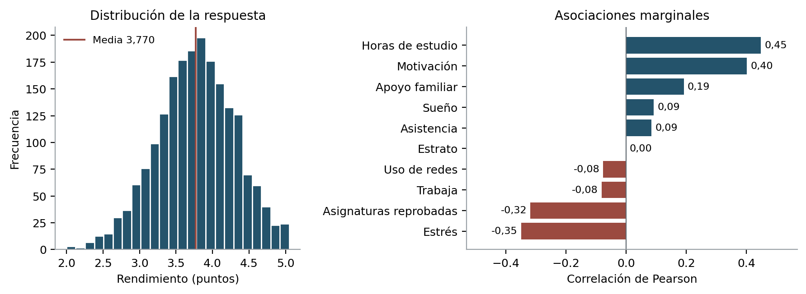
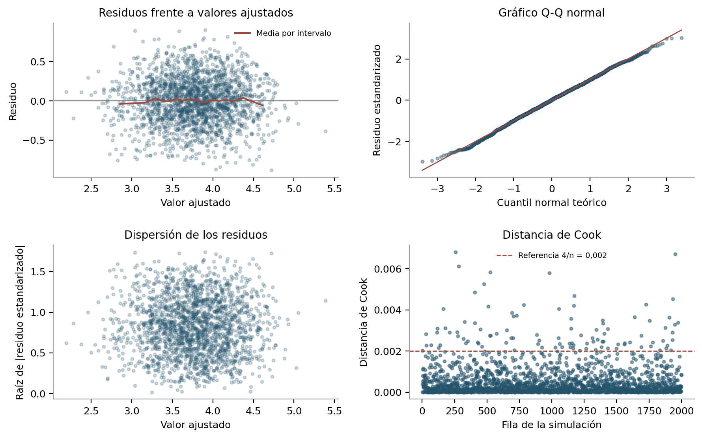
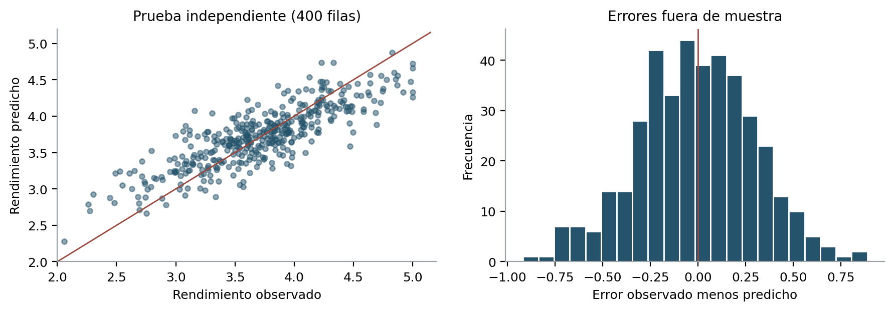

## Síntesis del análisis

Se ajustó una regresión lineal múltiple para explicar el rendimiento académico a partir de hábitos de estudio, asistencia, condiciones psicosociales y otras características. El análisis utiliza 2.000 observaciones **simuladas con el script suministrado en la actividad**. El modelo explica el 68,46 % de la variación observada y alcanza un RMSE de 0,304 puntos en una prueba de 400 registros que no participaron en su entrenamiento. Las horas de estudio y la motivación presentan asociaciones positivas. El estrés y las asignaturas reprobadas presentan asociaciones negativas. El estrato no muestra evidencia estadística suficiente de asociación lineal parcial en esta especificación.

El ajuste es útil para el ejercicio. Su alcance es didáctico: las relaciones principales fueron incorporadas al generar los datos. Además, se encontraron horas negativas y una limitación de la regresión ordinaria para respetar el rango de la nota. Por ello, los resultados no permiten establecer causas ni formular conclusiones sobre una población universitaria real.

## 1 Planteamiento y procedencia de los datos

La pregunta de trabajo es: **¿cómo se relacionan las variables incluidas en el material con el rendimiento académico y qué tan bien permite predecirlo un modelo lineal múltiple?** Se busca estimar esas asociaciones, interpretar sus coeficientes bajo control de las demás variables y evaluar tanto los supuestos como el error fuera de muestra.

La revisión de los archivos mostró una diferencia que afecta el desarrollo de la actividad. Aunque se llama `dataset_RegMultiple.xlsx`, el Excel contiene 90 registros y tres columnas: `ID`, `Metodo` y `Puntaje`. No contiene las variables del modelo propuesto. Por su parte, `Dataset_RegMultiple.R` genera una base de 2.000 registros con 15 variables de rendimiento académico. Se adoptó esta segunda fuente por su correspondencia con la consigna y el ejemplo de regresión.

La base utilizada se reconstruyó en R 4.3.3 con `set.seed(123)` y los generadores Mersenne-Twister, Inversion y Rejection. Se conservaron las distribuciones, el orden de las operaciones y la ecuación del archivo original. El error de exportación se resolvió usando el objeto `datos`, que es el creado por el script; el original intentaba exportar un objeto llamado `dataset`. La copia recibida no se modificó.

El procedimiento se presenta como una **simulación académica**. La actividad aborda un problema real, pero sus archivos no aportan una muestra observacional de estudiantes. Esta diferencia determina cómo deben leerse las conclusiones.

\newpage

## 2 Variables y revisión de calidad

La variable respuesta es `rendimiento`, una nota limitada al intervalo de 0 a 5. Se conservaron los diez predictores de la fórmula del material. La siguiente tabla precisa su codificación y evita confundir las unidades de los coeficientes.

| Variable | Significado y tratamiento |
|---|---|
| `rendimiento` | Nota simulada de 0 a 5. Respuesta cuantitativa. |
| `horas_estudio` | Cantidad de horas de estudio. El material no especifica el período de referencia. |
| `asistencia` | Porcentaje de asistencia entre 70 y 100. Un incremento de una unidad equivale a un punto porcentual. |
| `motivacion` | Puntuación simulada de 1 a 5, con decimales. Se trata como cuantitativa. |
| `estres` | Puntuación simulada de 1 a 5, con decimales. Se trata como cuantitativa. |
| `apoyo_familiar` | Puntuación simulada de 1 a 5, con decimales. Se trata como cuantitativa. |
| `reprobadas` | Número de asignaturas reprobadas. Variable de conteo. |
| `trabaja` | Indicador binario. 0 significa que no trabaja y 1 que trabaja. |
| `sueno` | Horas de sueño. Se interpreta por hora registrada; el material no formaliza su período. |
| `uso_redes` | Horas diarias de uso de redes sociales, según el comentario del generador. |
| `estrato` | Categorías de 1 a 6. Se modela inicialmente como una tendencia lineal, como en el ejemplo. |

La base también contiene `edad`, `genero`, `ingreso_familiar` y `horas_trabajo`. Se describen en el archivo de resultados, pero no se agregan al modelo principal. Este criterio conserva una especificación previa al análisis y evita incorporar predictores por tanteo. En el generador, `genero` se codifica como 0 para mujer y 1 para hombre.

**La ausencia de faltantes no garantiza datos plausibles.** No se encontraron celdas vacías ni filas duplicadas, pero sí 3 valores negativos en horas de estudio, 11 en horas de trabajo y 42 en uso de redes. Son 56 registros distintos, equivalentes al 2,8 % de la base. Las distribuciones normales sin truncar permiten esas realizaciones, aunque una duración negativa carece de sentido en una medición real.

Se conservaron las 2.000 filas para reproducir el ejercicio original. Después se repitió el ajuste excluyendo los 56 registros como análisis de sensibilidad. No se sustituyeron sus valores por cero. También se identificaron 15 notas iguales a 5, producidas por el límite superior del generador, y ninguna igual a 0. La edad mínima simulada es 12 años, otra señal de que la base no representa por sí misma una población universitaria definida.

\newpage

## 3 Exploración del conjunto de datos

El rendimiento medio es de 3,770 puntos y su desviación estándar es 0,530. La mitad central de las notas se encuentra entre 3,422 y 4,140. El 31 % de los registros corresponde a la categoría `trabaja = 1`. La asistencia media alcanza el 85,17 %.

**Tabla 1. Estadísticos de la respuesta y los predictores del modelo.**

| Variable | Media | DE | Mínimo | Máximo |
|---|---:|---:|---:|---:|
| Rendimiento | 3,77 | 0,53 | 2,05 | 5,00 |
| Horas de estudio | 14,94 | 4,99 | -4,00 | 31,00 |
| Asistencia | 85,17 | 8,78 | 70,00 | 100,00 |
| Motivación | 3,01 | 1,16 | 1,00 | 5,00 |
| Estrés | 3,05 | 1,16 | 1,00 | 5,00 |
| Apoyo familiar | 2,97 | 1,16 | 1,00 | 5,00 |
| Asignaturas reprobadas | 0,94 | 0,98 | 0,00 | 5,00 |
| Trabaja | 0,31 | 0,46 | 0,00 | 1,00 |
| Sueño | 6,95 | 1,49 | 1,80 | 12,60 |
| Uso de redes | 2,95 | 1,52 | -2,10 | 7,90 |
| Estrato | 2,54 | 1,33 | 1,00 | 6,00 |

*DE: desviación estándar muestral. Los valores negativos se muestran tal como fueron generados. Para los indicadores binarios, la media representa una proporción. Elaboración a partir de la simulación.*

{width=100%}

Las horas de estudio presentan la mayor correlación positiva con la nota ($r = 0{,}449$), seguidas por la motivación ($r = 0{,}402$). El estrés ($r = -0{,}348$) y las asignaturas reprobadas ($r = -0{,}318$) muestran asociaciones negativas. El estrato tiene una correlación cercana a cero. Estos valores describen pares de variables; la interpretación parcial se obtiene con el modelo múltiple.

\newpage

## 4 Ajuste del modelo

La regresión lineal permite estudiar una respuesta cuantitativa mediante varios predictores (James et al., 2013, cap. 3). Se estimó por mínimos cuadrados ordinarios, sin interacciones ni selección automática. La respuesta se mantiene en su escala de 0 a 5; las pruebas individuales contrastan $H_0:\beta_j=0$ con un nivel nominal de 0,05.

La ecuación estimada es:

$$
\begin{aligned}
\widehat{Y}={}&2{,}414689 + 0{,}048774H + 0{,}003978A + 0{,}198953M\\
 &-0{,}159582E + 0{,}102408F - 0{,}194610R - 0{,}086015T\\
 &+0{,}025021S - 0{,}028024U - 0{,}003527C.
\end{aligned}
$$

Aquí, $H$ son horas de estudio; $A$, asistencia; $M$, motivación; $E$, estrés; $F$, apoyo familiar; $R$, asignaturas reprobadas; $T$, trabaja; $S$, sueño; $U$, uso de redes; y $C$, estrato. La ecuación describe la media condicional estimada. El modelo estadístico incluye además un error $\varepsilon_i$, con media condicional supuesta igual a cero.

**Tabla 2. Coeficientes del modelo ajustado con las 2.000 observaciones.**

| Término | Coeficiente | Error estándar | IC del 95 % | p |
|---|---:|---:|---:|---:|
| Intercepto | 2,4147 | 0,0811 | [2,2555; 2,5738] | < 0,001 |
| Horas de estudio | 0,0488 | 0,0013 | [0,0461; 0,0514] | < 0,001 |
| Asistencia | 0,0040 | 0,0008 | [0,0025; 0,0055] | < 0,001 |
| Motivación | 0,1990 | 0,0058 | [0,1876; 0,2103] | < 0,001 |
| Estrés | -0,1596 | 0,0057 | [-0,1709; -0,1483] | < 0,001 |
| Apoyo familiar | 0,1024 | 0,0058 | [0,0911; 0,1137] | < 0,001 |
| Asignaturas reprobadas | -0,1946 | 0,0068 | [-0,2080; -0,1812] | < 0,001 |
| Trabaja | -0,0860 | 0,0145 | [-0,1144; -0,0576] | < 0,001 |
| Sueño | 0,0250 | 0,0045 | [0,0162; 0,0338] | < 0,001 |
| Uso de redes | -0,0280 | 0,0044 | [-0,0367; -0,0194] | < 0,001 |
| Estrato | -0,0035 | 0,0050 | [-0,0134; 0,0063] | 0,4829 |

*Intervalos y errores estándar convencionales de mínimos cuadrados. Los resultados se redondean para lectura; el código y los CSV conservan mayor precisión.*

El coeficiente de determinación es $R^2 = 0{,}6846$ y el ajustado es $0{,}6830$. Esto significa que el modelo recoge el **68,46 % de la variación de las notas dentro de esta base**. No significa que prediga correctamente al 68,46 % de los estudiantes. La desviación residual estimada es de 0,2984 puntos.

La prueba global da $F(10,1989)=431{,}67$, con $p<0{,}001$. Se rechaza que todas las pendientes sean simultáneamente cero. Ese resultado indica que al menos un predictor aporta asociación lineal; no demuestra que todos sean relevantes ni establece causalidad.

\newpage

## 5 Interpretación de los coeficientes

Cada pendiente representa un cambio en el rendimiento esperado **manteniendo constantes las demás variables del modelo**, como indica la guía de coeficientes suministrada. Las unidades importan. Un coeficiente pequeño puede corresponder a una variable medida en una escala más amplia.

**Horas de estudio.** Una hora adicional se asocia con un aumento de 0,0488 puntos en la nota. Para una diferencia de cinco horas, el contraste estimado es de 0,244 puntos, con un intervalo de confianza del 95 % entre 0,231 y 0,257. La interpretación conserva el período de medición del archivo, que no especifica si se trata de horas semanales.

**Asistencia.** Un punto porcentual adicional se asocia con 0,00398 puntos más de rendimiento. Pasar de 80 % a 90 % equivale a diez puntos porcentuales y representa un aumento estimado de 0,0398 puntos. En el generador, el término es `0.03 * asistencia / 10`: su pendiente por punto porcentual es 0,003, no 0,03. La estimación recupera una asociación pequeña y positiva.

**Motivación y apoyo familiar.** Un punto adicional en la escala de motivación se asocia con 0,1990 puntos más de nota. Para el apoyo familiar, la asociación por punto es de 0,1024. Ambos intervalos de confianza quedan por encima de cero. Estas escalas se tratan como cuantitativas por la estructura de la simulación; no se dispone de información sobre un instrumento de medición validado.

**Estrés y asignaturas reprobadas.** Un punto adicional de estrés se asocia con 0,1596 puntos menos de rendimiento. Una asignatura reprobada adicional se relaciona con una disminución de 0,1946 puntos. No se puede interpretar esta última relación como un efecto temporal sin conocer cuándo se midieron las reprobaciones y la nota.

**Trabajo.** Los registros de personas que trabajan presentan una nota esperada 0,0860 puntos menor que los de quienes no trabajan, bajo control de los otros predictores. El intervalo del 95 % va de −0,1144 a −0,0576. Es una comparación entre las categorías 1 y 0; no mide el efecto de una hora adicional de trabajo.

**Sueño y redes sociales.** Una hora adicional de sueño se asocia con 0,0250 puntos más de rendimiento. Una hora diaria adicional de redes se asocia con 0,0280 puntos menos. Son asociaciones de magnitud moderada o pequeña en la escala de la nota, aunque sus valores p son inferiores a 0,001.

**Estrato.** La pendiente es −0,0035 y su intervalo del 95 % incluye cero: [−0,0134; 0,0063]. Con $p=0{,}4829$, no hay evidencia suficiente de una tendencia lineal parcial. Esto no prueba que el contexto socioeconómico sea irrelevante en la vida real. En esta simulación, el estrato no forma parte de la ecuación que genera el rendimiento.

**Intercepto.** El valor 2,4147 corresponde a la predicción cuando todos los predictores valen cero. Ese perfil queda fuera del soporte de variables como asistencia y estrato. El intercepto es necesario para ajustar el plano de regresión, pero no representa la nota de un estudiante típico.

\newpage

## 6 Evaluación de los supuestos

Los gráficos de residuos complementan las pruebas numéricas; la normalidad se revisa sobre los errores aproximados por residuos, no sobre cada predictor. Montgomery et al. (2012, caps. 4, 6 y 9) desarrollan el uso de estos diagnósticos y de las medidas de influencia y colinealidad.

**Tabla 3. Diagnósticos del modelo principal.**

| Aspecto | Resultado | Lectura |
|---|---|---|
| Forma funcional | RESET $F(2,1987)=2{,}9946$; $p=0{,}0503$ | Resultado fronterizo. No se rechaza al 5 %, pero requiere cautela. |
| Varianza residual | Breusch-Pagan studentizado: $LM=6{,}8836$; 10 gl; $p=0{,}7364$ | No se detecta heterocedasticidad con esta prueba. |
| Normalidad | Shapiro-Wilk $W=0{,}9985$; $p=0{,}0830$ | No se rechaza normalidad al 5 %. No equivale a demostrarla. |
| Colinealidad | VIF entre 1,0012 y 1,0088 | No se observa inflación importante de las varianzas. |
| Independencia | Simulación sin estructura temporal; Durbin-Watson = 2,0211 | El diseño respalda la independencia. El estadístico por orden de fila es solo descriptivo. |

{width=100%}

El gráfico Q-Q se aproxima a la recta y los residuos se centran cerca de cero. El recorte de notas en 5 y el resultado fronterizo de RESET justifican mantener reservas sobre la forma lineal.

\newpage

## 7 Influencia y análisis de sensibilidad

La distancia de Cook máxima es 0,00681. Ninguna fila supera 1, pero 101 exceden la referencia $4/n=0{,}002$. Ese umbral sirve para localizar observaciones que conviene revisar, no como una orden de eliminación. También hay 22 filas con apalancamiento superior a $2p/n=0{,}011$, donde $p=11$ incluye el intercepto, y dos residuos studentizados externos con valor absoluto mayor que 3.

Se mantuvieron todos los registros en el análisis principal. La tabla siguiente permite comparar ese ajuste con dos escenarios de sensibilidad: excluir las 56 filas con horas negativas y excluir, por separado, las 101 alertas de Cook.

**Tabla 4. Estabilidad de las estimaciones bajo exclusiones de sensibilidad.**

| Término | Original | Sin horas negativas | Sin alertas de Cook |
|---|---:|---:|---:|
| Intercepto | 2,4147 | 2,4320 | 2,4732 |
| Horas de estudio | 0,0488 | 0,0483 | 0,0480 |
| Asistencia | 0,0040 | 0,0040 | 0,0036 |
| Motivación | 0,1990 | 0,1999 | 0,2004 |
| Estrés | -0,1596 | -0,1611 | -0,1632 |
| Apoyo familiar | 0,1024 | 0,1032 | 0,1004 |
| Asignaturas reprobadas | -0,1946 | -0,1943 | -0,1955 |
| Trabaja | -0,0860 | -0,0858 | -0,0783 |
| Sueño | 0,0250 | 0,0249 | 0,0246 |
| Uso de redes | -0,0280 | -0,0298 | -0,0275 |
| Estrato | -0,0035 | -0,0048 | -0,0038 |

*Tamaños de muestra: 2.000, 1.944 y 1.899, respectivamente. Son ajustes distintos; las exclusiones no se acumulan.*

Al retirar las horas negativas, la mayor variación absoluta entre las pendientes es de 0,0018, correspondiente al uso de redes. Los signos se mantienen. Al retirar las alertas de Cook, la diferencia más alta entre las pendientes es de 0,0078 para `trabaja`. La lectura sustantiva permanece similar. El aumento de $R^2$ al descartar observaciones influyentes no debe presentarse como una mejora predictiva: se están retirando casos en función del ajuste.

La inferencia con errores estándar robustos HC3 conserva las decisiones al 5 %: los nueve predictores distintos del estrato muestran evidencia de asociación y el estrato sigue sin hacerlo. HC3 modifica la estimación de incertidumbre, no los coeficientes ni la forma funcional del modelo.

También se comparó el tratamiento lineal del estrato con una codificación mediante cinco indicadores, tomando una categoría como referencia. Los cuatro parámetros adicionales no aportan evidencia de mejora frente a la tendencia lineal: $F=0{,}4577$ y $p=0{,}7668$. Se conserva la especificación del material. Esta comparación no convierte las categorías ordinales en una escala métrica ni prueba que las seis categorías tengan la misma media.

\newpage

## 8 Evaluación predictiva

Un buen ajuste en la muestra no basta para evaluar predicciones nuevas. Se separaron aleatoriamente 1.600 registros para entrenamiento y 400 para prueba, con semilla 2026. La fórmula se fijó antes de esta evaluación. El modelo entrenado con el 80 % se utilizó para predecir el 20 % restante, sin incorporar sus respuestas al ajuste.

El RMSE expresa la raíz del error cuadrático medio y penaliza más los errores grandes. El MAE mide el error absoluto medio. Ambos se reportan en puntos de la nota. El $R^2$ de prueba se calcula respecto a la media de las respuestas del conjunto de prueba.

**Tabla 5. Desempeño del modelo y comparación con una predicción constante.**

| Evaluación | n | RMSE | MAE | $R^2$ |
|---|---:|---:|---:|---:|
| Entrenamiento | 1600 | 0,2964 | 0,2373 | 0,6807 |
| Prueba | 400 | 0,3041 | 0,2426 | 0,6917 |
| Media de entrenamiento en prueba | 400 | 0,5515 | 0,4343 | -0,0140 |

La predicción de referencia asigna a todos los casos de prueba la nota media del entrenamiento. El modelo reduce su RMSE de 0,5515 a 0,3041, una disminución del **44,86 %**. Su MAE de 0,2426 indica que la diferencia absoluta entre predicción y observación promedia unas 0,24 unidades de nota. No significa que todos los errores sean menores que esa cifra.

{width=100%}

Como comprobación adicional, se realizó validación cruzada de cinco particiones dentro del entrenamiento, con semilla 2027. El RMSE promedio fue de 0,2985, con una desviación estándar entre particiones de 0,0071. La cercanía con el resultado de prueba no sugiere un deterioro marcado fuera de muestra en esta simulación; esa desviación no es un intervalo de confianza.

Los intervalos de predicción nominales del 95 % cubrieron 374 de los 400 valores observados, es decir, el 93,5 %. Una predicción puntual superó 5. La cobertura observada y el incumplimiento del límite de la nota muestran por qué el error medio debe acompañarse de una revisión de incertidumbre y rango.

\newpage

## 9 Ejemplo de predicción y discusión

Una vez terminada la evaluación de prueba, se considera el modelo ajustado con las 2.000 filas para ilustrar su uso. El perfil hipotético tiene 15 horas de estudio, 90 % de asistencia, motivación de 4, estrés de 2, apoyo familiar de 4, ninguna asignatura reprobada, no trabaja, 8 horas de sueño, 2 horas diarias de redes y estrato 3. Es un ejemplo construido para interpretar la ecuación, no una persona observada.

La predicción es de **4,524 puntos**. El intervalo de confianza del 95 % para la media de perfiles con esas características es [4,491; 4,557]. El intervalo de predicción del 95 % para un registro individual es más amplio: [3,938; 5,110]. El primero describe incertidumbre sobre la media; el segundo añade la variabilidad individual contemplada por el modelo.

El límite superior de 5,110 es incompatible con la escala de calificación. Se conserva tal como lo calcula el modelo para hacer visible la limitación. Recortarlo a 5 y seguir llamándolo un intervalo calibrado del 95 % no resolvería el problema estadístico. Para una aplicación real habría que evaluar un modelo que respete el límite, reunir datos adecuados y comprobar su calibración.

### Alcance de los hallazgos

La ecuación generadora asigna asociaciones positivas a estudio, asistencia, motivación, apoyo familiar y sueño; negativas a estrés, reprobaciones, trabajo y redes. El modelo recupera esos signos. Era razonable esperarlo, porque la simulación se construyó de esa manera. El ejercicio demuestra que la estimación puede recuperar una estructura conocida bajo ruido, pero no descubre qué determina el desempeño de estudiantes reales.

Las variables psicosociales se generaron sin un instrumento validado y varios predictores son independientes por construcción. Esto ayuda a explicar los VIF próximos a uno, una situación que podría cambiar en una base observacional. También faltan fechas y una población de referencia. Sin temporalidad, diseño causal y control suficiente de factores omitidos, no procede traducir las pendientes en efectos de una intervención.

## 10 Conclusiones

1. La regresión con los diez predictores del material explica el 68,46 % de la variación del rendimiento simulado. La prueba global respalda una asociación conjunta, mientras que el estrato no muestra una tendencia lineal parcial claramente distinta de cero.
2. El modelo mantiene un desempeño parecido dentro y fuera del entrenamiento: obtiene un RMSE de 0,304 puntos en prueba y supera la predicción basada únicamente en la media. Esa utilidad predictiva queda restringida al mecanismo de simulación analizado.
3. Los diagnósticos no muestran colinealidad importante ni evidencia clara de heterocedasticidad. RESET queda cerca del umbral de decisión, por lo que la adecuación de la forma funcional requiere una lectura prudente.
4. Las horas negativas y las predicciones fuera de la escala deben documentarse. Las comprobaciones de sensibilidad sostienen las asociaciones principales, pero no sustituyen la revisión del generador ni habilitan recomendaciones sobre estudiantes reales.

\newpage

## Referencias

James, G., Witten, D., Hastie, T., y Tibshirani, R. (2013). *An introduction to statistical learning: With applications in R*. Springer. Capítulo 3, pp. 59–126. https://doi.org/10.1007/978-1-4614-7138-7. Recursos del libro: https://www.statlearning.com/

Montgomery, D. C., Peck, E. A., y Vining, G. G. (2012). *Introduction to linear regression analysis* (5.ª ed.). Wiley. Capítulos 3, 4, 6, 9 y 11. [PDF suministrado en la actividad](https://www.kwcsangli.in/uploads/3--Introduction_to_Linear_Regression_Analysis__5th_ed._Douglas_C._Montgomery__Elizabeth_A._Peck__and_G._.pdf).

R Core Team. (s. f.). *Fitting linear models* [Documentación de `lm`]. https://stat.ethz.ch/R-manual/R-devel/library/stats/html/lm.html

R Core Team. (s. f.). *Predict method for linear model fits* [Documentación de `predict.lm`]. https://stat.ethz.ch/R-manual/R-devel/library/stats/html/predict.lm.html

R Core Team. (s. f.). *Random number generation* [Documentación de `RNGkind` y `set.seed`]. https://stat.ethz.ch/R-manual/R-devel/library/base/html/Random.html

*Dataset_RegMultiple.R*. (s. f.). [Script suministrado en la actividad]. Material de clase sin autor identificado en el archivo.

*Guía Interpretación coeficientes*. (s. f.). [Presentación de diapositivas suministrada en la actividad]. Material de clase sin autor identificado en el archivo.

*dataset_RegMultiple.xlsx*. (s. f.). [Archivo suministrado en la actividad]. Se revisó para contrastar su contenido con el generador; no se utilizó para estimar el modelo.

### Reproducción del análisis

El archivo `analisis_regresion_multiple.R` reconstruye la base, calcula el modelo y exporta tablas de coeficientes, intervalos, diagnósticos por fila, particiones y predicciones. Utiliza funciones incluidas en R y no necesita instalar paquetes adicionales. La base entregada es `datos_simulados_R.csv`. La sesión de referencia corresponde a R 4.3.3.

Desde la carpeta del trabajo se ejecuta:

```bash
Rscript analisis_regresion_multiple.R
```

El script complementario `generar_informe.py` crea las figuras y las versiones Markdown, LaTeX, PDF y HTML a partir de las tablas. Sus dependencias están en `requirements.txt`; la compilación requiere Pandoc y XeLaTeX. El código fuente del informe y las figuras se incluyen para permitir la revisión de la presentación.

La matriz de mínimos cuadrados se contrastó mediante un cálculo independiente en Python; las diferencias frente a R fueron inferiores a $10^{-12}$. La base exportada también se comparó con la ejecución del generador original, corrigiendo únicamente su llamada de exportación. Las cifras de este documento proceden de esos cálculos, no de valores inventados para ilustrar resultados.

\newpage

## Anexo de uso de inteligencia artificial

### Propósito y alcance

Se utilizó ChatGPT, de OpenAI, para reproducir el ejercicio y comparar un proceso ya desarrollado, con un rol de **revisor técnico (viewer) y corrector ortográfico y de redacción**. La revisión tomó como referencia el material de clase, el código y la primera versión del informe. Durante su preparación, la herramienta también apoyó la adaptación y ejecución del código, la elaboración de gráficos y la redacción de las interpretaciones.

### Solicitud de reproducción y comparación

Para revisar esta versión, la petición se reformuló así:

> Actúa como revisor técnico (viewer) y corrector ortográfico de un ejercicio de regresión lineal múltiple ya desarrollado. Reproduce el procedimiento y compara sus coeficientes, medidas de ajuste, diagnósticos y predicciones con los resultados existentes.
>
> Identifica instrucciones que funcionen en el entorno actual, pero puedan fallar o producir resultados distintos en otras condiciones. Explica la causa y sugiere cambios justificados. Revisa las interpretaciones y corrige ortografía, puntuación y concordancia, conservando el sentido del texto y las cifras verificadas.

### Sugerencias realizadas sobre el código

**Reproducibilidad de la simulación.** El uso de `set.seed(123)` es válido y permite repetir los datos bajo la misma configuración. Sin embargo, la semilla por sí sola no fija los algoritmos aleatorios activos. Si estos cambian entre sesiones o versiones de R, la misma semilla puede producir otra secuencia. La documentación de R registra, por ejemplo, un cambio en el algoritmo predeterminado de `sample()` a partir de la versión 3.6.0 (R Core Team, s. f., *Random number generation*).

Se sugirió hacer explícita la configuración antes de fijar la semilla:

```r
RNGkind("Mersenne-Twister", "Inversion", "Rejection")
set.seed(123)
```

Este ajuste conserva el método de regresión y evita depender de una configuración implícita. La versión entregada ya lo incorpora. También se documentó R 4.3.3 como entorno de referencia y se mantuvo el orden de las operaciones.

**Referencia al objeto exportado.** El archivo original construye `datos`, pero intenta exportar `dataset`. Esa instrucción podría escribir la base correcta si `dataset` existiera previamente y contuviera los mismos datos. En una sesión limpia fallaría; si contuviera otra base, exportaría información equivocada. Se sugirió usar explícitamente el objeto creado por el script. Para conservar Excel, la corrección sería:

```r
write.xlsx(datos, "dataset_RegMultiple.xlsx")
```

La versión entregada utiliza `write.csv(datos, ...)`, con el mismo criterio y sin requerir el paquete de exportación a Excel.

### Comprobación de las sugerencias

La configuración explícita reprodujo la base entregada. Una prueba con otro algoritmo de muestreo y la misma semilla produjo diferencias en la base, confirmando el riesgo señalado. Los coeficientes y errores estándar se contrastaron entre R y Python, con diferencias inferiores a $10^{-12}$. Las sugerencias y la revisión lingüística conservaron las cifras del informe.
